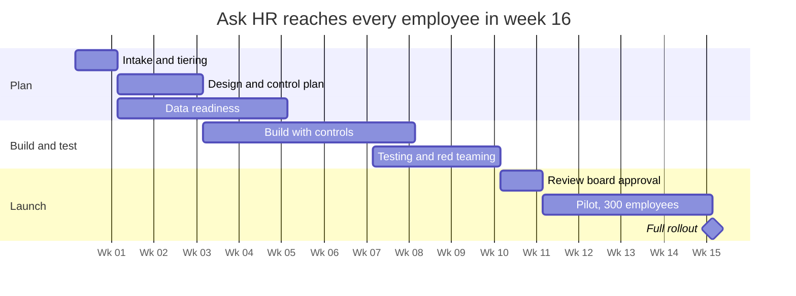

# Case study: Governing a high-risk HR agent on the Microsoft stack

## Summary

Contoso’s HR team piloted an employee policy assistant in week 12 and rolled it out to all 8,000 employees by week 16, after intake rated it High risk. Governance added about six weeks to a standard build. In return, it caught two flaws that would have exposed salary and leave data, and it produced an evidence packet that a review board could approve with confidence.

This is a fictional scenario built to show how the companion [interactive control matrix](https://ifekiitan.github.io/ai-governance-matrix/) works in practice. Contoso is a stand-in company; the platforms and controls are real Microsoft capabilities.

## The scenario

HR wants “Ask HR,” a Copilot Studio agent in Microsoft Teams that answers policy questions and handles simple requests, so HR advisors can spend less time on routine tickets.

| Aspect | Detail |
| --- | --- |
| Users | 8,000 employees in the US, UK, Germany, Spain, and Poland |
| Channel | Microsoft Teams |
| Knowledge sources | HR policy library in SharePoint; employee records in a Fabric lakehouse |
| Read actions | Leave balance, benefits eligibility, policy lookups |
| Write actions | Submit a leave request; open an HR case for a human advisor |
| Out of scope | Pay changes, performance, hiring, discipline, or any decision about an employee |

Intake rated it **High** for three reasons. It reads personal data, including sensitive categories like medical leave. It takes write actions on an employee’s behalf. And a wrong answer about benefits or leave could cost someone money.

Legal confirmed it falls outside the EU AI Act’s high-risk employment categories, because it makes no decisions about workers. Contoso kept the High tier anyway, based on its own internal criteria.

## Phase by phase

Each phase ends at a gate with a clear exit test. Every control produces evidence, such as a screenshot, test result, or log, which is filed in a single approval packet.

1. **Intake and tiering (week 1).** The HR business owner submits a one-page intake form covering purpose, users, data, and actions. The AI governance lead scores impact, data sensitivity, and autonomy, then assigns the tier.
   - Controls: agent registered in the AI inventory with a named business owner.
   - Exit test: tier agreed by the business owner and governance lead.
2. **Design review and control plan (weeks 2–3).** The governance lead generates the High-tier checklist from the matrix and assigns an owner to every control. Privacy starts a data protection impact assessment, and legal begins works council consultation in Germany.
   - Controls: decision boundaries written down, such as “the agent never decides on pay or eligibility.”
   - Exit test: every control has an owner and a due date.
3. **Data readiness (weeks 2–5, in parallel).** The data steward and platform admin clean up what the agent can reach before anyone builds it.
   - Controls: Purview oversharing assessment, sensitivity labels, DLP to keep highly confidential content out of Copilot, Fabric row-level security, and lineage in the Purview Data Map.
   - Exit test: no grounding source open to broader access than intended.
4. **Build with controls (weeks 4–8).** The agent builder works in a managed Copilot Studio environment with DLP connector policies.
   - Controls: user authentication so the agent acts with each employee’s own permissions, confirmation before submitting leave, AI disclosure, source citations, and handoff to a human advisor. Security creates the agent’s identity in Entra under Conditional Access.
   - Exit test: build checklist complete, with evidence attached.
5. **Testing and red teaming (weeks 8–10).** The red team attacks the agent, and the builder runs quality evaluations.
   - Controls: prompt injection and data leakage testing, groundedness evaluations in every supported language, and accessibility testing against WCAG.
   - Exit test: no open critical or high findings.
6. **Approval gate (week 11).** The Responsible AI review board examines the evidence packet and the impact assessment, then decides go, go with conditions, or no-go.
   - Exit test: signed decision with any conditions recorded.
7. **Pilot and staged rollout (weeks 12–15).** A pilot runs with 300 employees across all five countries, behind a kill switch, before expanding to everyone in week 16.
   - Controls: monitoring dashboards, an AI incident playbook in Sentinel, and Purview DSPM for AI watching for sensitive data exposure.
   - Exit test: pilot metrics meet targets for two straight weeks.
8. **Operate and monitor (ongoing).** The business owner reviews metrics monthly. The governance lead recertifies the agent every quarter.
9. **Change and retirement.** Any new data source, action, or user group sends the agent back to intake. At retirement, access is revoked, the agent identity is deleted, and logs are kept per retention policy.

## Who does what

The AI governance lead runs the process, but owns very few controls directly. Their job is to make sure every control has an owner, every owner produces evidence, and the review board gets an honest picture.

| Role | What they own |
| --- | --- |
| AI governance lead | Intake, tiering, the control plan, the evidence packet, and quarterly recertification |
| Business owner (HR Director) | The agent’s purpose, its decision boundaries, pilot results, and accepting residual risk |
| Agent builder (HR technology) | Building in Copilot Studio, evaluations, and fixing findings |
| Data steward (People Analytics) | Data quality, labels, and who can see which records |
| Platform admin (Microsoft 365 and Power Platform) | Managed environments, DLP policies, and oversharing fixes |
| Security | Agent identity in Entra, threat monitoring, red teaming, and incident response |
| Privacy and legal | The impact assessment, regulatory fit, and works council consultation |
| Responsible AI review board | The go or no-go decision |

R = does the work, A = accountable for the outcome, C = consulted, I = informed.

| Activity | Gov lead | Business owner | Builder | Data steward | Platform admin | Security | Privacy and legal | Review board |
| --- | --- | --- | --- | --- | --- | --- | --- | --- |
| Intake and tiering | R | A | C | C | I | C | C | I |
| Control plan | R/A | C | C | C | C | C | C | I |
| Data readiness | C | I | I | R/A | R | C | C | I |
| Build with controls | C | A | R | C | C | C | I | I |
| Red teaming | C | I | C | I | I | R/A | I | I |
| Impact assessment | C | C | C | C | I | C | R/A | I |
| Approval decision | R | C | I | I | I | C | C | A |
| Pilot and monitoring | C | A | R | I | C | R | I | I |
| Incident response | C | A | R | C | C | R | C | I |
| Quarterly recertification | R/A | C | C | C | I | C | C | I |

## Collaborators

Eleven groups touched this project, but only four were involved throughout. Bringing the others in at the right moment, not all at once, is what kept the process from stalling.

| Group | Why they’re needed | When | Estimated effort |
| --- | --- | --- | --- |
| HR leadership | Sponsors the agent and accepts residual risk | Throughout | 2 hours per week |
| HR technology team | Builds and maintains the agent | Throughout | 1 to 2 people full time |
| AI governance office | Runs the process and evidence packet | Throughout | 30% of one person |
| Microsoft 365 and Power Platform admins | Environments, DLP, oversharing fixes | Throughout | 4 hours per week |
| People Analytics | Owns employee data in Fabric | Weeks 2–5, then monthly | 1 person for 4 weeks |
| Security operations | Entra identity, Defender, Sentinel playbook | Weeks 4–8, then on call | 6 hours per week |
| Red team | Adversarial testing | Weeks 8–10 | 2 people for 2 weeks |
| Privacy office | Data protection impact assessment | Weeks 2–7 | 10 hours total |
| Employment legal | Regulatory fit and works council | Weeks 2–9 | 15 hours total |
| German works council | Required consultation on employee-facing tools | Weeks 3–9 | 3 meetings |
| Accessibility and internal comms | WCAG testing, launch messaging, pilot recruitment | Weeks 8–16 | 1 week each |

The German works council was the longest single dependency. Starting that consultation in week 3, rather than after the build, saved an estimated month.

## Timeline

A High-tier agent takes about 16 weeks from intake to full rollout, and roughly six of those are governance work. Running data readiness and the impact assessment alongside the build is what keeps it from taking longer.

Lower tiers move much faster, because they skip the heaviest gates.

| Tier | Typical time to launch | What drives the timeline |
| --- | --- | --- |
| Low | 1 to 2 weeks | Self-service checklist, with spot checks by the governance lead |
| Medium | 4 to 6 weeks | Data readiness and a lighter review, with no board approval |
| High | 12 to 16 weeks | Impact assessment, red teaming, board approval, and a staged pilot |

The usual causes of slippage are employee or works council consultation, permissions cleanup when data turns out to be overshared, and red team findings that need rework.

## Issues found and fixed

Five issues surfaced before launch, and two of them would have exposed personal data. Fixing them used up the two weeks of buffer built into the schedule.

| Issue | Found in | Control that caught it | Fix | Delay |
| --- | --- | --- | --- | --- |
| A compensation spreadsheet on an HR SharePoint site was visible to all 400 HR staff, so the agent could have quoted salaries | Data readiness, week 3 | Purview oversharing assessment | Permissions narrowed, file labeled highly confidential, and DLP set to exclude it from Copilot | 1 week |
| A manager asking about “my team’s leave” saw team members’ medical leave, because a connector used a shared service account | Red teaming, week 9 | Agents act with the user’s own permissions | Connector switched to user authentication | 1 week |
| Answers in Polish and Spanish were grounded in policy far less often than English answers | Testing, week 9 | Groundedness evaluation per language | Translated policy documents added as sources | None for the pilot |
| Leave requests could be submitted without the employee confirming dates | Build review, week 7 | Confirmation before write actions | Confirmation card added | None |
| Screen readers could not announce the leave request buttons | Testing, week 10 | WCAG testing with Accessibility Insights | Button labels fixed | None |

## After launch

The business owner reviews these metrics monthly, and any metric outside its threshold for two weeks opens a review.

| Metric | Target | Owner | Source |
| --- | --- | --- | --- |
| Answers grounded in policy | 90% or more in every language | Agent builder | Foundry evaluations on sampled conversations |
| Sensitive data exposure incidents | Zero | Security | Purview DSPM for AI and Sentinel |
| Time to contain an AI incident | Under 4 hours | Security | Sentinel incident log |
| Conversations handed to a human advisor | Tracked for trend, not targeted | Business owner | Copilot Studio analytics |
| Employee satisfaction with answers | 4 out of 5 or higher | Business owner | In-chat feedback |
| Quarterly recertification completed on time | 100% | AI governance lead | AI inventory |

The agent goes back through intake if it gains a new data source, action, or user group, or if a sensitive data incident occurs.

## What this case shows

Governance works when it is a delivery process, not a review at the end. Every control here had an owner, a deadline, and evidence, which is why the review board could say yes with conditions instead of stalling.

The six weeks of governance work were cheap compared to the alternative: a salary spreadsheet quoted to the wrong person, or a manager seeing a colleague’s medical leave. Both were caught by specific controls from the matrix, on specific Microsoft platforms, before a single employee used the agent.

---

*Independent portfolio concept. Not affiliated with or endorsed by Microsoft.*
